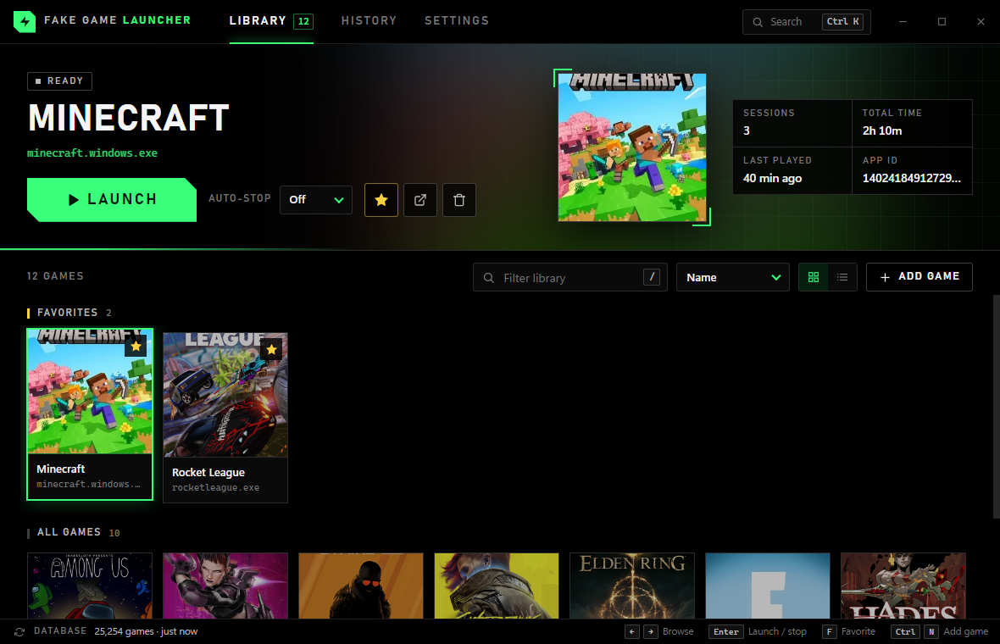
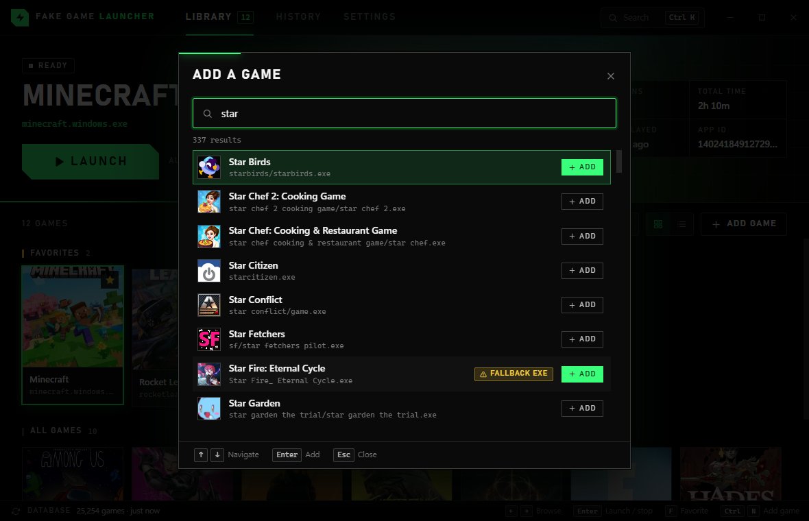
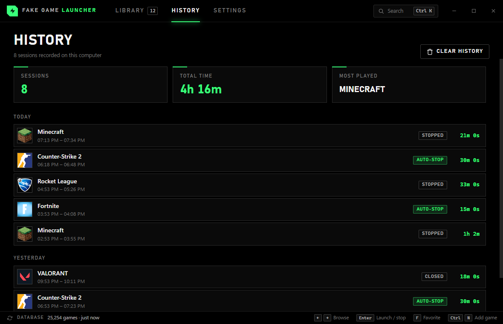

# Discord Fake Game Launcher

A Windows desktop app that makes Discord think a game is running, without installing the game.

You pick a game from Discord's own list of detectable games, and the launcher starts a tiny placeholder window under that game's executable name. Discord sees the process and shows the game as being played.



> [!IMPORTANT]
> This tool is intended for educational purposes and personal testing. Please respect Discord's Terms of Service and the rights of Discord's partners, game publishers and advertisers when using it.
>
> Discord is a registered trademark of Discord Inc. It is referenced here for descriptive purposes only and does not imply any affiliation, sponsorship or endorsement by Discord Inc.

## Features

- **Console-style library.** A hero banner for the selected game, with Running, Favorites and All games shelves below. Switch to a compact list and sort by name, recently played or most played.
- **Game artwork.** Covers and icons appear on tiles, the hero banner, history and search. Games without an image show their initials.
- **Run several games at once.** Each one has a live session timer, and a pill in the top bar shows how many are running.
- **Auto-stop.** Stop a game automatically after 5 minutes to 4 hours, per launch or as a default.
- **Session history.** Start time, duration and how each session ended, with play-time totals.
- **System tray.** Closing the window keeps running games going. Stop them or quit from the tray icon.
- **Library import and export** as a JSON file.
- **Desktop shortcuts** that start a single game directly.
- **Keyboard first.** Arrow keys, a quick-search palette and shortcuts for every common action.

| Add a game | History |
| --- | --- |
|  |  |

## Install

Windows 10 or 11 is required.

1. Get the app in one of two ways:
   - Download the installer (`Discord Fake Game Launcher Setup x.y.z.exe`) or the portable exe from the [Releases](../../releases) page, if a release has been published.
   - Or [build it yourself](#build-from-source).
2. Run it. The installer asks for administrator permission, installs to `C:\Program Files\Discord Fake Game Launcher` and adds desktop and Start menu shortcuts. The portable exe runs without installing.

The app is not code-signed, so Windows SmartScreen may warn the first time. Choose **More info**, then **Run anyway**.

## How to use it

1. Open the app. It downloads Discord's list of detectable games on first start.
2. Click **Add game** (or press `Ctrl+N`), search for a game and add it.
3. Select the game and press **Launch** (or `Enter`). A small window opens under the game's exe name, and Discord picks it up within a few seconds.
4. Press **Stop** when you are done, or set **Auto-stop** before launching.

Games marked **Fallback exe** in the search list have no executable name in Discord's list. The launcher makes one up from the title, so Discord may not detect them.

### Keyboard shortcuts

| Action | Keys |
| --- | --- |
| Search games and commands | `Ctrl+K` |
| Add a game | `Ctrl+N` |
| Filter the library | `/` |
| Move between games | Arrow keys |
| Launch or stop the selected game | `Enter` |
| Favorite the selected game | `F` |
| Remove the selected game | `Del` |
| Library, History, Settings | `Ctrl+1`, `Ctrl+2`, `Ctrl+3` |
| Close a dialog | `Esc` |

## How it works

1. The app downloads the list of detectable applications from Discord's public API and saves it as `gamelist.json`.
2. When you launch a game, it copies a small placeholder program (`DummyGame.exe`) into its data folder under the game's real executable path, for example `games/<app id>/win64/cs2.exe`.
3. It starts that copy. The window does nothing except stay open, but its process name matches what Discord looks for.

Everything is stored in `%APPDATA%\discord-fake-game-launcher-ui`:

| File | Contents |
| --- | --- |
| `myGames.json` | Your library and favorites |
| `gamelist.json` | Discord's detectable games list |
| `settings.json` | Preferences |
| `history.json` | The last 500 sessions |
| `games/` | The generated placeholder executables |

The app talks to `discord.com` for the games list and `cdn.discordapp.com` for game images. Images are loaded when shown and are not saved in your library. Builds made with an update feed also check GitHub for new releases.

## Build from source

You need [Node.js](https://nodejs.org) (LTS). The [.NET 8 SDK](https://dotnet.microsoft.com/download) is optional: without it, the placeholder program is compiled with the C# compiler that ships with Windows.

```bash
cd electron
npm install
```

Run the app in development:

```bash
npm run build:dummy:bundle
npm run dev
```

Build the installer and the portable exe into `electron/dist/`:

```bash
npm run dist:local
```

| Script | What it does |
| --- | --- |
| `npm run dev` | Starts the app from source |
| `npm run build:dummy:bundle` | Builds `DummyGame.exe` into `build-resources/dummygame` |
| `npm run dist:local` | Builds the installer and portable exe for personal use, with no update feed |
| `npm run dist` | Builds the installer with the GitHub update feed from `package.json` |
| `npm run dist:publish` | Builds and uploads the installer to GitHub Releases |

If you publish your own fork, change `repository.url` and `build.publish` in `electron/package.json` to your repository first. Otherwise builds made with `npm run dist` look for updates in this repository.

Pushing a tag named `release_X.Y.Z` runs the release workflow, which builds the installer and attaches it to a GitHub release.

## Project layout

| Path | Purpose |
| --- | --- |
| `electron/src/main.js` | Main process: windows, tray, launching, history, settings, updates |
| `electron/src/safe-paths.js` | Turns executable names from the games list into safe file paths |
| `electron/src/preload.js` | The API the UI is allowed to call |
| `electron/src/renderer/` | The UI: `index.html`, `styles.css`, `ui.js`, `renderer.js` |
| `electron/scripts/` | Build helpers |
| `src/DummyGame/` | The placeholder window that runs under a game's exe name |
| `src/Launcher/` | The old console launcher, kept only to forward to the app |

## Troubleshooting

- **Discord does not show the game.** Check that the game is not marked **Fallback exe**, and that Discord's setting to share your detected activity is on. Give it a few seconds after launching.
- **The old icon still shows after updating.** Windows caches icons by file path. Refresh the desktop or sign out and back in. The installer also asks Windows to refresh them.
- **"DummyGame.exe was not found" when launching from source.** Run `npm run build:dummy:bundle` in the `electron` folder.
- **The app keeps running after closing the window.** That is the tray setting. Quit from the tray icon, or turn off **Keep running in the tray** in Settings.

## Credits

Based on [discord-fake-game-launcher](https://github.com/Jeardey/discord-fake-game-launcher) by Jeardey.
